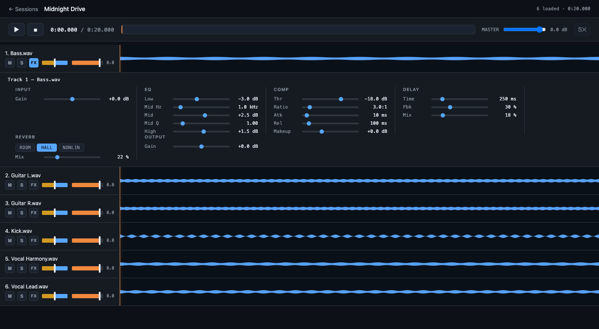

# daw-here

A single-binary, browser-based DAW-style audition player for folders of multitrack sessions.

Point it at a folder of session subfolders and it serves a per-session mixer in the browser — sample-accurate playback with volume, pan, mute/solo, EQ, compression, delay, and reverb on every track. No install, no project files, no database: the binary walks the filesystem and everything else happens client-side via the Web Audio API.



## How it works

Each immediate subdirectory of `--root` is treated as a session; every audio file inside becomes a track. Open a session in the browser and all of its tracks load and play back in sync, with a full per-track channel strip:

- Volume, pan, mute, solo
- 3-band EQ (low shelf / sweepable mid peak / high shelf)
- Compressor (threshold / ratio / attack / release / makeup gain)
- Delay (time / feedback / mix)
- Reverb (room / hall / nonlin) with mix
- Input and output gain

Click **FX** in any track header to drop its channel strip below the row.

## Build

Needs Go 1.22+ (for the `net/http` mux pattern syntax).

```sh
go build -o daw-here .
```

The web assets are embedded into the binary via `//go:embed`, so the resulting executable is fully self-contained — copy it anywhere and run.

For a stripped, smaller binary:

```sh
go build -ldflags="-s -w" -o daw-here .
```

## Run

```sh
./daw-here --root /path/to/sessions
# defaults: --host 127.0.0.1 --port 8765
```

To expose on the LAN:

```sh
./daw-here --host 0.0.0.0 --root /path/to/sessions
```

Then open `http://<host>:8765/`.

| Flag     | Default     | Description                              |
| -------- | ----------- | ----------------------------------------- |
| `--root` | `.`         | Directory containing session subfolders   |
| `--host` | `127.0.0.1` | Host to bind to (`0.0.0.0` for LAN access)|
| `--port` | `8765`      | TCP port to listen on                     |

## Supported audio

`.wav` `.flac` `.mp3` `.ogg` `.oga` `.opus` `.aif` `.aiff` `.m4a` `.aac`

Decoding happens in the browser via the Web Audio API, so support depends on your browser. Chrome, Safari, and Firefox all cover the common formats.

## Notes

- Sessions zipped from Cambridge MT (and similar) often have a single redundant top-level directory; the server descends through up to four such wrappers to find the actual track files.
- `.DS_Store` and `._*` resource-fork files are ignored.
- Audio is served with HTTP Range support so seeking works over slow networks.
